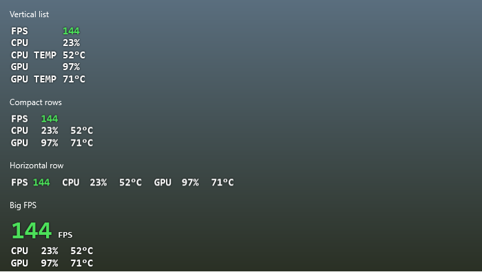
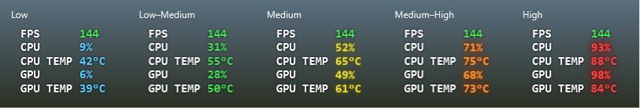
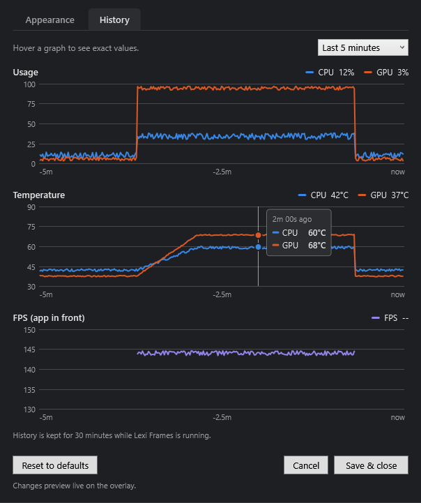
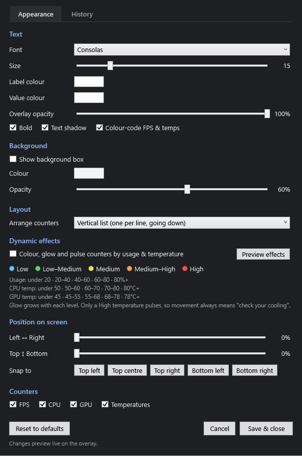

<p align="center">
  
</p>

<h1 align="center">Lexi Frames</h1>

<p align="center">
  A tiny, minimal in-game overlay for Windows that shows <b>FPS</b>, <b>CPU / GPU usage</b> and <b>CPU / GPU temperature</b> on top of any game or app.<br>
  No injection into games, under 1% CPU, fully customisable.
</p>

---

## Features

- **FPS for whatever is in front.** Works with DirectX 9/10/11/12, and with Vulkan and OpenGL through the kernel present events. FPS is calculated from real frame timestamps, so the number is steady (a 30 FPS cap reads 30.0).
- **CPU & GPU usage and temperature**, read through LibreHardwareMonitor.
- **Four layouts:** a vertical list, compact rows, a horizontal row, or a big FPS number with stats below.

  

- **Dynamic effects (optional):** counters colour, glow and smoothly blend across five heat levels, from Low to High. Only a *High temperature* pulses, so movement always means "check your cooling".

  

- **History graphs:** usage, temperature and FPS over the last 1 / 5 / 15 / 30 minutes, with hover tooltips.

  

- **Customisable:** font, size, colours, text shadow, an optional background box, opacity, and which counters show.
- **Position anywhere:** sliders in % of the screen, plus *Snap to* corner buttons. The overlay stays anchored to its edge.
- **Stays out of the way:** click-through, never steals focus, hidden from Alt+Tab, and **Ctrl+Shift+O** toggles it.
- **Lightweight:** measured during gameplay at about 0.4% CPU, 0.05% GPU and 60 MB of RAM.

<details>
<summary>Options window</summary>



</details>

*Screenshots show sample values.*

## Download & install

1. Download the latest `LexiFrames-vX.Y.Z-win-x64.zip` from the [Releases](https://github.com/alexandernieuwoudt-glitch/lexi-frames/releases/latest) page.
2. Unzip it anywhere and run **`LexiFrames.exe`**. It asks for administrator rights, which it needs to read FPS events and hardware sensors.
3. **Optional, for CPU temperature:** install the free [PawnIO](https://pawnio.eu) driver:
   ```
   winget install namazso.PawnIO
   ```
   Without it, everything works except CPU temperature, which shows `--`.

> **"Windows protected your PC"?** The exe isn't code-signed, which is normal for small open-source tools. Click **More info → Run anyway**, or build it yourself from source (below).

The release build is self-contained, so you don't need to install .NET.

## Usage

| Action | How |
|---|---|
| Open Options | Right-click the green **L** tray icon → **Options...**, or double-click the icon |
| Show / hide overlay | **Ctrl+Shift+O**, or the tray menu |
| Quit | Tray menu → **Exit** |
| Debug log | Run `LexiFrames.exe --log` (writes `overlay-log.txt` next to the exe) |

Settings are saved to `%AppData%\LexiFrames\settings.json`.

**Fullscreen games:** the overlay shows over **borderless / windowed fullscreen**. True *exclusive fullscreen* draws over every window, so switch a game to borderless if the overlay disappears.

## How it works

- **FPS:** an ETW (Event Tracing for Windows) session listens for present events from the `Microsoft-Windows-DXGI`, `D3D9` and `DxgKrnl` providers, the same technique [PresentMon](https://github.com/GameTechDev/PresentMon) uses. Nothing is injected into the game process, which keeps it friendly with anti-cheat.
- **Sensors:** [LibreHardwareMonitorLib](https://github.com/LibreHardwareMonitor/LibreHardwareMonitor) (NVAPI / ADL for GPUs, PawnIO for CPU temperature).
- **Overlay:** a transparent, topmost, click-through WPF window.

## Dynamic effect thresholds

| Level | Colour | Usage | CPU temp | GPU temp |
|---|---|---|---|---|
| Low | cyan | < 20% | < 50°C | < 45°C |
| Low–Medium | green | 20–40% | 50–60°C | 45–55°C |
| Medium | yellow | 40–60% | 60–70°C | 55–68°C |
| Medium–High | orange | 60–80% | 70–80°C | 68–78°C |
| High | red | 80%+ | 80°C+ | 78°C+ |

These are defined in [`CounterEffects.cs`](CounterEffects.cs).

## Build from source

Requirements: Windows 10/11 and the [.NET 8 SDK](https://dotnet.microsoft.com/download/dotnet/8.0).

```powershell
git clone https://github.com/alexandernieuwoudt-glitch/lexi-frames.git
cd lexi-frames
dotnet build -c Release
```

To make a release zip (a self-contained single exe plus the licence files):

```powershell
.\tools\build-release.ps1
```

The zip is written to `release\`.

The logo is generated by `tools\make-icon.ps1`.

## Licence

[MIT](LICENSE). See [THIRD-PARTY-NOTICES.md](THIRD-PARTY-NOTICES.md) for the libraries used.
